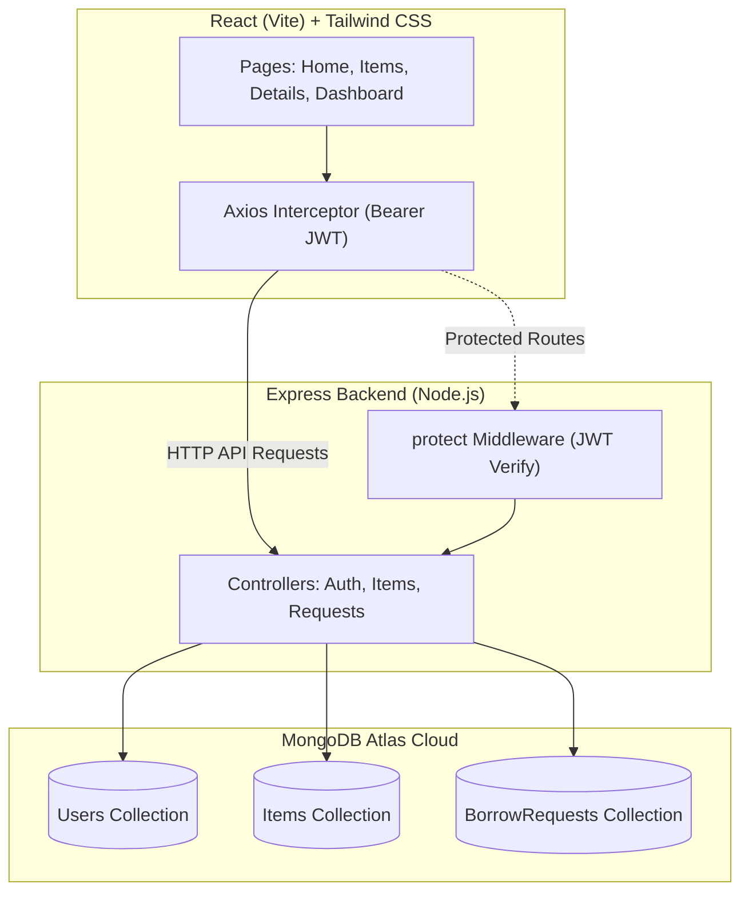

# BorrowBox 📦
> **"Don't buy it, borrow it."**

[](#tech-stack)
[](https://tailwindcss.com/)
[](LICENSE)

BorrowBox is a campus-focused peer-to-peer web application where students lend and borrow items (scientific calculators, lab coats, sports equipment, textbooks, prep guides, and chargers) instead of buying things they need only once.

---

## 🌐 Live Demo & Screenshots

- **Live Application:** [https://borrowbox.vercel.app](https://your-borrowbox-app.vercel.app) *(Replace with your Vercel URL)*
- **API Health Check:** [https://borrowbox-api.onrender.com/api/health](https://your-borrowbox-api.onrender.com/api/health) *(Replace with your Render URL)*

<!-- PLACEHOLDER FOR SCREENSHOTS -->
> _(Screenshots: Add images of the Home Page, Browse Catalog, Item Details modal, and 3-tab Dashboard here)_

---

## 🚀 Key Features

1. **Authentication (JWT & Bcrypt)**: Secure student registration and login with token persistence and session restoration.
2. **Item Catalog & Real-Time Filtering**: Search with a 400ms debounce, category filter pills, and an "Available only" switch.
3. **Item Listing & Live Preview**: Real-time card preview updating as you type title, category, condition, and image URL.
4. **Borrow Request Workflow**: Choose start and due dates within the item's maximum borrow duration with custom notes to the owner.
5. **Owner Approval Engine**: Owner approves with one click (marking the item Borrowed and auto-rejecting competing requests) or rejects.
6. **Return Cycle Management**: Owner marks items as Returned, immediately restoring them to Available.
7. **3-Tab Dashboard**:
   - **My Items**: Manage your listed gear and delete listings (protected against deleting borrowed items).
   - **My Requests**: Track status, contact owners, and monitor days remaining.
   - **Incoming Requests**: Respond to peer inquiries with instant email contact buttons.
8. **Overdue Tracking**: Automatic visual indicator flagging approved items whose due date has passed.

---

## 🛠️ Tech Stack

- **Frontend**: React 18, Vite, React Router v7, Axios, Tailwind CSS v4, Lucide React icons, React Hot Toast.
- **Backend**: Node.js, Express, MongoDB Atlas, Mongoose, JSON Web Tokens (JWT), Bcryptjs, Morgan, Helmet, Express Rate Limit.
- **Deployment**: Vercel (Client) + Render (Server) + MongoDB Atlas (Database).

---

## 📐 Architecture & Data Flow



---

## 🔄 The Borrow Lifecycle

```
[Borrower sends request]
           │
           ▼
     ┌───────────┐
     │  PENDING  │ ──(Owner Rejects)──> [ REJECTED ] (End)
     └─────┬─────┘
           │ (Owner Approves)
           ▼
     ┌───────────┐
     │ APPROVED  │ ──> Item status turns "BORROWED"
     └─────┬─────┘     (Other pending requests auto-rejected)
           │
           │ (Item in physical use... Overdue badge if dueDate passes)
           │
           ▼ (Owner marks returned)
     ┌───────────┐
     │ RETURNED  │ ──> Item status restored to "AVAILABLE" (End)
     └───────────┘
```

---

## 📁 Folder Structure

```
borrowbox/
├── client/                     # React Frontend (Vite)
│   ├── public/
│   │   └── favicon.svg         # Branded box favicon
│   ├── src/
│   │   ├── api/
│   │   │   └── axios.js        # Shared Axios instance + interceptors
│   │   ├── components/         # Button, Input, Select, Card, Badge, Modal, Navbar, etc.
│   │   ├── context/
│   │   │   └── AuthContext.jsx # Auth state, login/register, token persistence
│   │   ├── hooks/              # useAuth, useDebounce
│   │   ├── pages/              # Home, Items, ItemDetails, AddItem, Dashboard, Login, Register, NotFound
│   │   └── utils/              # dateHelpers (formatDate, isOverdue, daysLeft)
│   ├── .env                    # VITE_API_URL
│   ├── vercel.json             # SPA routing rewrite
│   └── vite.config.js          # Tailwind v4 plugin + Port 5173
│
├── server/                     # Express Backend
│   ├── config/
│   │   └── db.js               # MongoDB connection
│   ├── controllers/            # authController, itemController, requestController
│   ├── middleware/             # authMiddleware (protect), errorMiddleware
│   ├── models/                 # User, Item, BorrowRequest
│   ├── routes/                 # authRoutes, itemRoutes, requestRoutes
│   ├── utils/                  # asyncHandler, generateToken, seed.js
│   ├── .env                    # PORT, MONGO_URI, JWT_SECRET, CLIENT_URL
│   └── server.js               # Express entrypoint + Helmet + Rate Limiters
│
├── .gitignore
├── PROJECT_BRIEF.md
└── README.md
```

---

## 🔌 API Endpoints Table

All endpoints are prefixed with `/api`. Standard response format:
- Success: `{ "success": true, "message": "...", "data": ... }`
- Error: `{ "success": false, "message": "..." }`

| Method | Endpoint | Access | Description |
|---|---|---|---|
| `POST` | `/auth/register` | Public | Register new user; returns user + JWT |
| `POST` | `/auth/login` | Public | Authenticate user; returns user + JWT |
| `GET` | `/auth/me` | Protected | Get currently authenticated user profile |
| `GET` | `/items` | Public | Browse items; supports `?search=` and `?category=` |
| `GET` | `/items/mine` | Protected | Get items created by logged-in user |
| `POST` | `/items` | Protected | Create a new item listing |
| `GET` | `/items/:id` | Public | Get single item details (populated owner) |
| `DELETE` | `/items/:id` | Protected (Owner) | Delete item (blocked if currently Borrowed) |
| `POST` | `/requests` | Protected | Create borrow request `{ itemId, fromDate, dueDate, message }` |
| `GET` | `/requests/mine` | Protected | Get borrow requests sent by current user |
| `GET` | `/requests/incoming` | Protected | Get incoming borrow requests on user's items |
| `PUT` | `/requests/:id/approve` | Protected (Owner) | Approve request, set item Borrowed, reject other pendings |
| `PUT` | `/requests/:id/reject` | Protected (Owner) | Reject borrow request |
| `PUT` | `/requests/:id/return` | Protected (Owner) | Mark request Returned, restore item to Available |

---

## 🔐 Environment Variables

### Server (`server/.env`)
```ini
PORT=5000
MONGO_URI=mongodb+srv://<username>:<password>@<cluster>.mongodb.net/borrowbox?retryWrites=true&w=majority
JWT_SECRET=your_super_secret_random_hex_key_here
JWT_EXPIRES_IN=7d
CLIENT_URL=http://localhost:5173
```

### Client (`client/.env`)
```ini
VITE_API_URL=http://localhost:5000/api
```

---

## 💻 Local Setup & Installation

### 1. Clone the repository
```bash
git clone https://github.com/your-username/borrowbox.git
cd borrowbox
```

### 2. Backend Setup
```bash
cd server
npm install

# Copy example env and fill in your MONGO_URI and JWT_SECRET
cp .env.example .env

# (Optional) Seed the database with demo users & items
npm run seed

# Start development server
npm run dev
```

### 3. Frontend Setup
```bash
# In a new terminal window:
cd client
npm install

# Copy example env
cp .env.example .env

# Start Vite dev server
npm run dev
```
Open **`http://localhost:5173`** in your browser.

---

## 👥 Demo Logins (from Seed Script)

All demo accounts share the password: **`password123`**

| Name | Email | Password | Pre-seeded Gear |
|---|---|---|---|
| **Aanya Sharma** | `demo1@borrowbox.com` | `password123` | Scientific Calculator, Microscope, Geometry Set, Chemistry Book |
| **Rohan Mehta** | `demo2@borrowbox.com` | `password123` | Canon DSLR, Lab Coat *(Borrowed)*, Cricket Bat, Blazer |
| **Priya Nair** | `demo3@borrowbox.com` | `password123` | CLRS Algorithm Book, Badminton Racket, Copic Markers, Power Bank |

---

## 🚢 Deployment Guide

Follow these exact steps to deploy BorrowBox live for free:

### Step 1: Push Code to GitHub
```bash
git add .
git commit -m "feat: complete BorrowBox MVP"
git branch -M main
git remote add origin https://github.com/<your-github-username>/borrowbox.git
git push -u origin main
```

### Step 2: Ensure MongoDB Atlas Allows Global Access
1. Log in to [MongoDB Atlas](https://cloud.mongodb.com).
2. Go to **Network Access** under Security in the left sidebar.
3. Check that an IP entry exists for `0.0.0.0/0` (Allow Access from Anywhere). If not, click **Add IP Address** ➔ **Allow Access from Anywhere** ➔ **Confirm**.

### Step 3: Deploy Backend on Render
1. Sign up/log in at [Render.com](https://render.com).
2. Click **New +** ➔ **Web Service**.
3. Connect your GitHub repository.
4. Configure with these exact settings:
   - **Name**: `borrowbox-api`
   - **Root Directory**: `server`
   - **Environment**: `Node`
   - **Build Command**: `npm install`
   - **Start Command**: `node server.js`
   - **Instance Type**: `Free`
5. Click **Advanced** ➔ **Add Environment Variable**:
   - `PORT` = `5000`
   - `MONGO_URI` = *(your MongoDB Atlas connection string)*
   - `JWT_SECRET` = *(a long random string)*
   - `JWT_EXPIRES_IN` = `7d`
   - `CLIENT_URL` = `https://temporary.com` *(we will update this in Step 5)*
6. Click **Deploy Web Service**.
7. Once deployed, copy your Render URL (e.g., `https://borrowbox-api.onrender.com`).
8. Test health endpoint: `https://borrowbox-api.onrender.com/api/health`.

### Step 4: Deploy Frontend on Vercel
1. Sign up/log in at [Vercel.com](https://vercel.com).
2. Click **Add New...** ➔ **Project**.
3. Import your `borrowbox` repository.
4. In project configuration:
   - **Framework Preset**: `Vite`
   - **Root Directory**: Click Edit ➔ select `client`
5. Under **Environment Variables**:
   - **Name**: `VITE_API_URL`
   - **Value**: `https://borrowbox-api.onrender.com/api` *(your Render API URL from Step 3 + `/api`)*
6. Click **Deploy**.
7. Once finished, copy your live Vercel URL (e.g. `https://borrowbox.vercel.app`).

### Step 5: Connect CORS & Live URLs
1. Return to your Render Dashboard for `borrowbox-api`.
2. Go to **Environment** tab.
3. Update `CLIENT_URL` to your live Vercel URL (e.g. `https://borrowbox.vercel.app`).
4. Click **Save Changes** (Render will automatically redeploy with the updated CORS rule).

---

## 🧪 Live Site Smoke-Test Checklist

Once deployed, run this quick 2-minute checklist on your live URL:

1. [ ] **Health Check**: Open `https://<your-render-url>/api/health` ➔ should return `{ "success": true, "message": "BorrowBox API running" }`.
2. [ ] **Browse Public Catalog**: Open your Vercel URL ➔ navigate to `/items` and confirm items load with images and badges.
3. [ ] **Search & Filter**: Search `calculator` and toggle categories; confirm results filter properly.
4. [ ] **Login**: Sign in with `demo1@borrowbox.com` / `password123` ➔ verify welcome toast and name appear in the navbar.
5. [ ] **Create Item**: Go to `/add-item`, publish a test item, and confirm redirect to the item detail page.
6. [ ] **Send Request**: In an incognito window, log in as `demo2@borrowbox.com`, request the newly added item.
7. [ ] **Approve & Return Cycle**: As `demo1`, open Dashboard ➔ **Incoming Requests**, click **Approve**, verify status turns **Borrowed**, and then click **Mark Returned**.
8. [ ] **Refresh Route**: Press `F5` / `Cmd+R` on `/dashboard` or `/items/:id` ➔ confirm the page reloads cleanly without 404 errors (verifying `vercel.json`).
